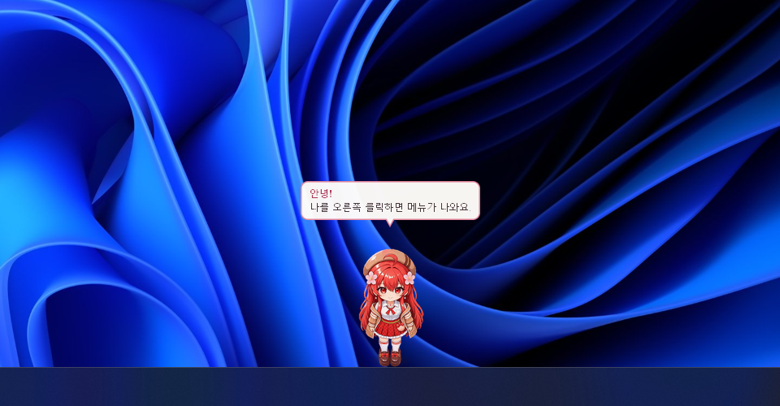
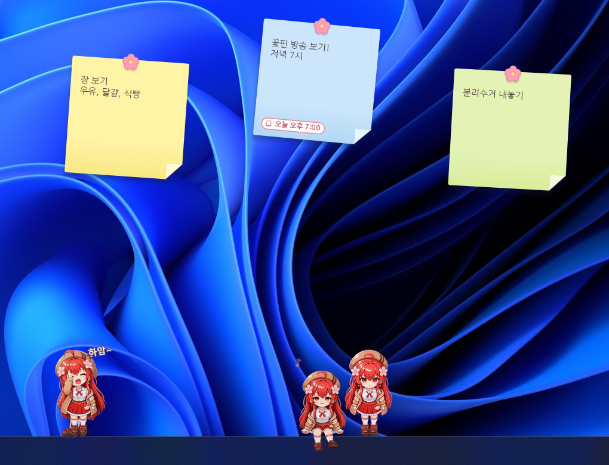
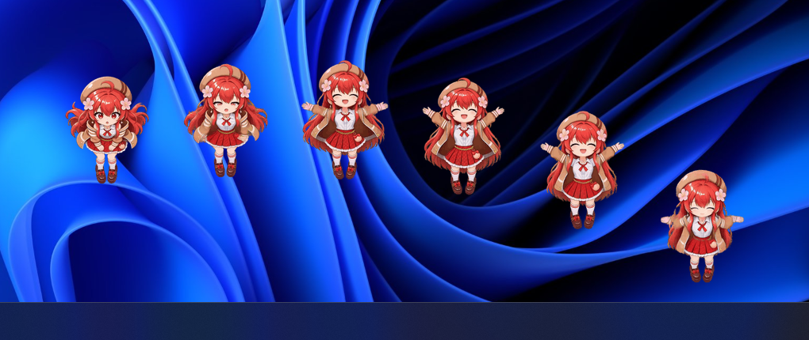
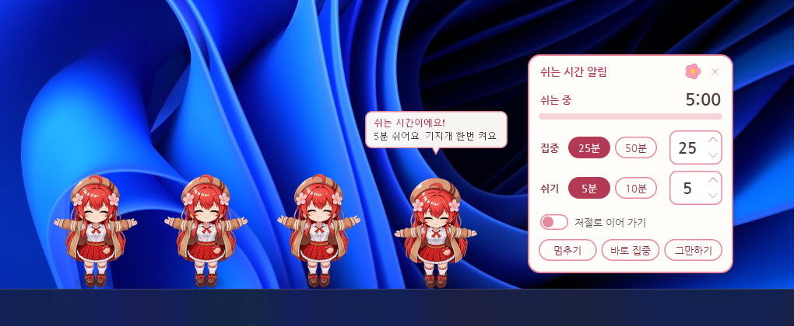
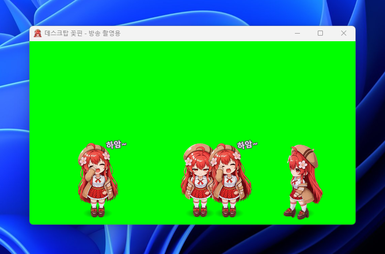
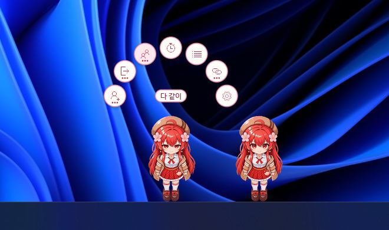
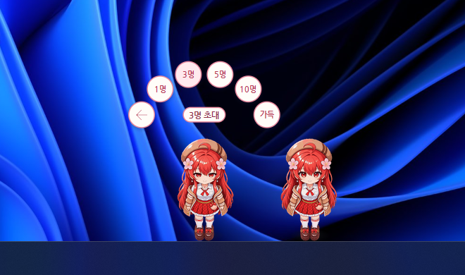

<div align="center">

# 데스크탑 꽃핀

**꽃핀이 바탕화면 위를 걸어 다니는 Windows 데스크탑 캐릭터**

[**받기**](https://github.com/namo40/desktop-flowerpin/releases/latest) · [쓰는 법](#쓰는-법) · [자주 묻는 것](#자주-묻는-것)



꽃핀 무료 팬게임입니다. 판매하지 않습니다.

</div>

## 받기

1. [Releases](https://github.com/namo40/desktop-flowerpin/releases/latest)에서 `DesktopFlowerpin-버전-windows-x64.zip`을 받아 압축을 모두 풉니다.
2. `DesktopFlowerpin.exe`를 실행합니다.

Windows 10 이상(64비트)에서 됩니다.

> **처음 실행할 때 "Windows의 PC 보호" 창이 뜰 수 있습니다.**
> 코드 서명을 하지 않은 프로그램이라 그렇습니다. "추가 정보"를 누른 뒤 "실행"을 누르면 켜집니다.

## 이런 것을 합니다



- **바탕화면을 돌아다닙니다.** 작업표시줄 위와 다른 창 위를 걷고, 쉬고, 기지개를 켜고, 하품을 합니다. 가장자리에 걸터앉기도 하고, 자리를 비우면 잠듭니다.
- **만지면 반응합니다.** 클릭하거나, 머리를 문지르거나, 잡아서 옮길 수 있습니다. 올라선 창을 흔들면 떨어지고, 마우스 커서를 작업표시줄 위쪽에 잠깐 두면 그 아래로 걸어옵니다.
- **방송이 켜지면 알려 줍니다.** 꽃핀의 치지직 방송이 시작되면 말풍선과 Windows 알림으로 알립니다.
- **메모를 붙여 둡니다.** 포스트잇에 메모를 적어 화면에 붙이고, 시각을 정해 알림을 받습니다.
- **친구를 부릅니다.** 꽃핀을 한 번에 40명까지 초대할 수 있습니다. 초대한 꽃핀은 정해 둔 시간이 지나면 돌아갑니다.
- **꽃핀끼리 놉니다.** 옆 꽃핀이 기지개를 켜면 따라 켜고, 여럿이 모이면 가끔 파도처럼 차례로 뜁니다.
- **쉬는 시간을 알려 줍니다.** 정한 시간(처음은 25분) 집중하면 꽃핀들이 기지개를 켜며 쉬자고 합니다.
- **방송 화면에 올릴 수 있습니다.** "방송 촬영용 창"을 OBS 같은 방송 프로그램의 창 캡처로 잡고 크로마 키로 바탕색을 빼면, 꽃핀만 방송 화면에 올라갑니다. 창이 열려 있는 동안은 꽃핀들이 그 창 안에서 지냅니다.
- **방해하지 않습니다.** 게임이나 영상을 전체 화면으로 볼 때, 화면이 잠겼거나 꺼졌을 때는 숨어서 멈춥니다. 방송 촬영용 창 안의 꽃핀은 전체 화면에서도 그대로입니다.

**여럿이 모이면 파도처럼 차례로 뜁니다**



**쉬는 시간이 되면 기지개를 켜며 알려 줍니다**



**방송 촬영용 창 안에서 지냅니다**



## 쓰는 법

꽃핀을 **오른쪽 클릭**하면 머리 위에 단추가 뜹니다.



| 단추 | 하는 일 |
|---|---|
| 초대하기 | 꽃핀을 1명, 3명, 5명, 10명 더 부르거나, 남은 자리만큼 가득 부릅니다 |
| 보내기 | 그 꽃핀을 돌려보내거나, 처음 꽃핀 1명만 남기고 모두 돌려보냅니다 (꽃핀이 둘 이상일 때) |
| 다 같이 | 파도 점프, 기지개, 하품 가운데 하나를 나와 있는 꽃핀들이 하던 것을 멈추고 모두 선 뒤에 한 번에 합니다 (꽃핀이 둘 이상일 때) |
| 쉬는 시간 | 쉬는 시간 알림 판을 엽니다 |
| 메모 목록 | 메모를 모아 보고, 새 메모를 붙입니다 |
| 바로 가기 | 꽃핀의 치지직 방송, 유튜브, 팬카페를 엽니다 |
| 설정 | 설정 창을 엽니다 |

"초대하기", "보내기", "다 같이", "바로 가기"는 묶음 단추입니다. 누르면 그 안의 단추들이 나오고, 맨 앞의 화살표를 누르면 돌아옵니다.



| 하고 싶은 것 | 이렇게 |
|---|---|
| 꽃핀 옮기기 | 잡아서 끌어다 놓습니다. 다른 창 위에도 올려놓을 수 있습니다 |
| 쓰다듬기 | 머리 위에서 마우스를 문지릅니다 |
| 새 메모 | 트레이 메뉴의 "메모 → 새 메모"나 메모 목록의 "+ 새 메모" |
| 메모에 알림 넣기 | 포스트잇에 마우스를 올리면 나오는 종 모양 단추 |
| 여러 명 초대하기 | 트레이 메뉴의 "여러 명 초대하기" |
| 다 같이 파도 점프 · 기지개 · 하품 | 트레이 메뉴의 "다 같이" |
| 쉬는 시간 알림 | 머리 위의 "쉬는 시간" 단추나 트레이 메뉴의 "쉬는 시간 알림..."로 판을 열고, 집중 시간과 쉬는 시간을 골라 시작합니다. 판은 끌어서 옮길 수 있고, 제목 줄의 꽃 핀으로 항상 위를 켜고 끕니다 |
| 방송 화면에 꽃핀 올리기 | 트레이 메뉴의 "방송 촬영용 창...". 창이 열려 있는 동안 꽃핀들은 창 안에서 지냅니다. 창의 빈 곳을 오른쪽 클릭하면 초대하기, 1명만 남기고 보내기, 다 같이, 바탕색 메뉴가 뜹니다 |
| 잠깐 숨기기 | 트레이 메뉴의 "잠깐 숨기기" |
| 크기 바꾸기, Windows 시작할 때 실행 | 설정 창의 "일반" 탭 |
| 커서 따라오기 끄기 | 설정 창의 "꽃핀" 탭 |
| 끝내기 | 트레이 메뉴의 "끝내기" |

트레이 메뉴는 작업표시줄 오른쪽의 꽃핀 아이콘을 오른쪽 클릭하면 뜹니다. 아이콘이 보이지 않으면 ∧(숨겨진 아이콘 표시)를 눌러 보세요.

## 자주 묻는 것

<details>
<summary><b>"Windows의 PC 보호" 창이 떠요</b></summary>

코드 서명을 하지 않은 프로그램이라 처음 실행할 때 뜹니다. "추가 정보"를 누른 뒤 "실행"을 누르면 됩니다.

받은 파일이 맞는지는 SHA-256으로 확인할 수 있습니다. PowerShell에서 `Get-FileHash 받은파일.zip`으로 나온 값이 릴리스 글에 적힌 값과 같으면 됩니다.

</details>

<details>
<summary><b>인터넷을 쓰나요?</b></summary>

두 가지에만 씁니다. 둘 다 설정 창에서 끌 수 있고, 둘 다 끄면 인터넷을 전혀 쓰지 않습니다.

- **방송 상태 확인**: 꽃핀의 방송이 켜졌는지 치지직에 묻습니다(기본 1분마다). 치지직의 **비공식 주소**를 씁니다. 아래 [방송 상태 확인](#방송-상태-확인-비공식-api-사용)을 읽어 주세요.
- **새 버전 확인**: 새 버전이 나왔는지 하루에 한 번 GitHub에 묻습니다. 새 버전이 있으면 알려만 주고, 받아서 바꾸는 일은 직접 하셔야 합니다. 앱이 스스로 내려받거나 제 파일을 고치지 않습니다.

</details>

<details>
<summary><b>내 메모와 설정은 어디에 저장되나요?</b></summary>

`%APPDATA%\DesktopFlowerpin` 폴더에만 저장합니다. 메모는 암호화하지 않은 보통 파일(`memos.json`)이고, 어디에도 보내지 않습니다. 비밀번호 같은 것은 메모에 적지 마세요.

</details>

<details>
<summary><b>새 버전은 어떻게 받나요?</b></summary>

새 버전이 나오면 꽃핀이 말풍선으로 알려 주고, 트레이 메뉴 맨 위에 "새 버전 받기"가 생깁니다. 누르면 받는 곳이 열립니다. 새 압축 파일을 받아 풀고, 예전 폴더는 지우면 됩니다. 메모와 설정은 그대로 남습니다.

</details>

<details>
<summary><b>꽃핀이 안 보여요</b></summary>

- 전체 화면 프로그램을 쓰는 동안에는 숨습니다. 끝내면 다시 나옵니다.
- 트레이 아이콘을 왼쪽 클릭하면 꽃핀이 반짝여 있는 곳을 알려 줍니다.
- 트레이 메뉴에 "다시 보이기"가 있으면 잠깐 숨겨 둔 것입니다.

</details>

<details>
<summary><b>지우려면 어떻게 하나요?</b></summary>

1. 설정에서 "Windows 시작할 때 실행"을 켰다면 먼저 끕니다.
2. 트레이 메뉴에서 "끝내기"를 고릅니다.
3. 압축을 푼 폴더를 지웁니다.
4. 메모와 설정까지 지우려면 `%APPDATA%\DesktopFlowerpin` 폴더를 지웁니다. 탐색기의 주소 칸에 그대로 붙여 넣으면 그 폴더가 열립니다.

</details>

## 이 프로그램이 하는 일

숨기는 것 없이 적어 둡니다.

- 관리자 권한을 쓰지 않습니다. 설치 없이 exe 하나로 실행합니다.
- 설정과 메모는 `%APPDATA%\DesktopFlowerpin` 폴더에만 저장합니다.
- 꽃핀이 다른 창 위에 올라설 수 있게, 화면에 보이는 창들의 자리와 앞뒤 순서를 읽습니다. 창의 제목이나 내용은 읽지 않습니다.
- 커서 따라오기를 켜 두면 마우스 커서의 자리를 0.25초마다 읽습니다. 자리 말고는 읽지 않고, 어디에도 적거나 보내지 않습니다.
- 전체 화면 프로그램(게임, 발표, 전체 화면 영상)이 떠 있는지와 화면이 잠겼는지, 꺼졌는지를 Windows에 묻습니다. 그동안에는 꽃핀을 숨기고 멈춥니다. 어떤 프로그램인지는 읽지 않습니다.
- 레지스트리는 설정에서 "Windows 시작할 때 실행"을 켰을 때만 씁니다. 로그인한 사용자의 `HKCU\Software\Microsoft\Windows\CurrentVersion\Run`에 실행 파일의 자리를 적고, 끄면 지웁니다.
- 인터넷은 방송 상태 확인과 새 버전 확인에만 씁니다. 방송 상태 확인은 치지직의 **비공식 주소**를 씁니다. 둘 다 설정에서 끄면 인터넷을 전혀 쓰지 않습니다.
- 새 버전 확인은 하루에 한 번 `https://api.github.com/repos/namo40/desktop-flowerpin/releases/latest`를 부릅니다. 로그인 정보와 쿠키를 보내지 않고, 보내는 것은 이 주소와 프로그램 이름(`DesktopFlowerpin/버전`)뿐입니다. 받은 답에서는 가장 새 버전의 번호만 읽습니다.

## 방송 상태 확인 (비공식 API 사용)

꽃핀의 치지직 방송이 켜지면 말풍선과 Windows 알림으로 알려 주는 기능입니다. 처음부터 켜져 있고, 처음 실행할 때 말풍선으로 한 번 알립니다.

**이 기능은 치지직이 공식으로 공개한 API를 쓰지 않습니다.**

- 치지직 웹 페이지가 쓰는 주소 하나를 불러 방송 상태를 읽습니다.

  ```
  https://api.chzzk.naver.com/polling/v2/channels/a86031fdfeb1b223ad1172cf6ba4b94e/live-status
  ```

- 치지직 공식 Open API에는 채널의 방송이 켜졌는지 알려 주는 기능이 없어서 이 주소를 씁니다(2026년 11월 확인).
- 치지직(네이버)의 허락을 받거나 제휴한 것이 아닙니다. 이 주소는 예고 없이 바뀌거나 막힐 수 있고, 그러면 이 기능만 멈춥니다.

부담을 줄이려고 이렇게 합니다.

- 위 주소 하나만, 고른 간격(1분·3분·5분, 기본 1분)으로 부릅니다. 응답 하나는 약 1.5KB입니다.
- 로그인 정보와 쿠키를 보내지 않습니다. 보내는 것은 위 주소와 프로그램 이름(`DesktopFlowerpin/버전`)뿐입니다.
- 받는 것은 방송 상태, 제목, 카테고리, 시청자 수, 시작 시각입니다. 방송 영상은 받지 않습니다.
- 치지직이 요청을 거절하거나(HTTP 401·403·429) 응답의 모양이 달라지면, 다른 길을 찾지 않고 확인을 멈춥니다. 다른 주소로 넘겨도 따라가지 않습니다.
- 연결이 안 되면 다시 묻는 간격을 10분까지 늘립니다.

끄려면 설정 창의 "방송" 탭에서 "방송 상태 확인"을 끄면 됩니다. 끄면 치지직에는 아무것도 묻지 않습니다.

## 라이선스

- 코드: MIT (`LICENSE`)
- 그림: 코드 라이선스에 포함되지 않습니다. 이 글에 쓴 화면 그림(`docs/images`)도 그렇습니다. `LICENSE-ASSETS.md`를 봐 주세요.
- 글꼴: 메모(포스트잇)의 글자는 네이버에서 제공한 나눔글꼴(나눔고딕)로 그립니다. 글꼴 파일은 `crates/app/res/fonts`에 있고 실행 파일에 함께 들어갑니다. SIL Open Font License 1.1을 따르며, 저작권 안내와 라이선스 전문은 같은 폴더의 `LICENSE-NanumGothic.txt`에 있습니다. 코드의 MIT 라이선스는 글꼴에 적용되지 않습니다.
- 바로 가기 아이콘: 꽃핀을 오른쪽 클릭했을 때 뜨는 단추의 치지직, 유튜브, 네이버 카페 아이콘은 저마다의 상표입니다. 공식 아이콘을 크기만 맞춰 `crates/app/res/icons`에 두었고 실행 파일에 함께 들어갑니다. 모양과 색은 바꾸지 않았습니다. 코드의 MIT 라이선스는 이 아이콘에 적용되지 않습니다.
