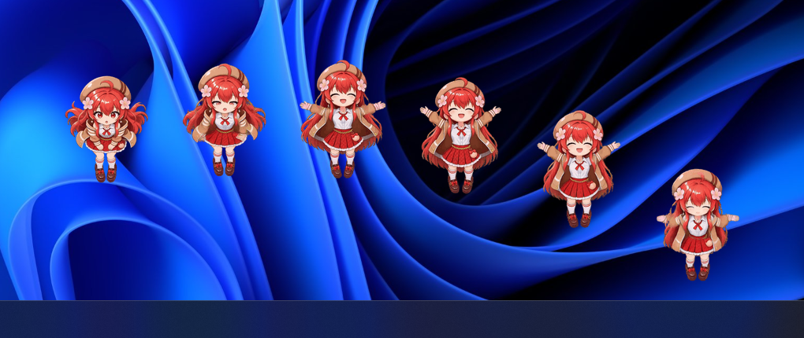
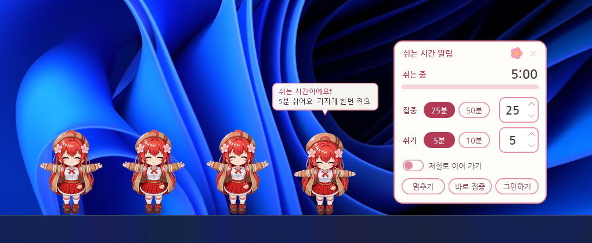
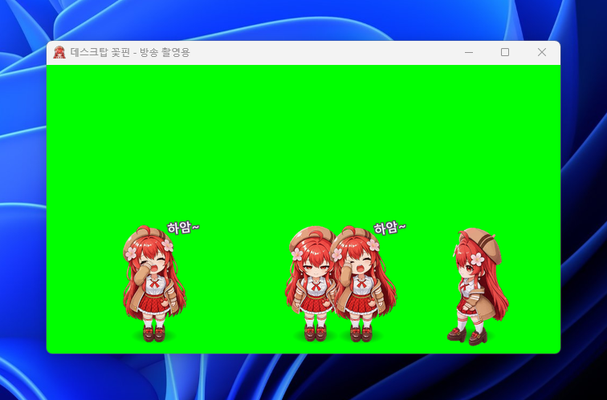
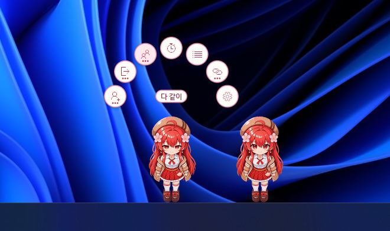
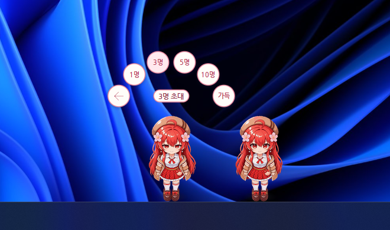

꽃핀이 바탕화면 위를 걸어 다니는 Windows 데스크탑 캐릭터입니다. 꽃핀 공지에 따라 만든 무료 팬게임이고, 판매하지 않습니다.

## 0.1.1에서 달라진 것

- 옆 꽃핀의 기지개·하품·점프를 따라 하고, 여럿이 모이면 가끔 파도처럼 차례로 뜁니다. 트레이 메뉴나 머리 위 단추의 "다 같이"로 시키면 모두 하던 행동을 멈추고 선 뒤에 한 번에 함께 합니다.

  

- 꽃핀이 올라선 창을 빠르게 흔들면 떨어집니다.
- 마우스 커서를 작업표시줄 위쪽에 잠깐 두면 가까운 꽃핀이 걸어옵니다. 설정 창의 "꽃핀" 탭에서 끌 수 있습니다.
- 쉬는 시간 알림: 정한 시간 집중하면 꽃핀들이 기지개를 켜며 쉬자고 합니다. 머리 위 단추의 "쉬는 시간"이나 트레이 메뉴의 "쉬는 시간 알림..."로 판을 열어 시간을 고르고 시작합니다.

  

- 트레이 메뉴의 "방송 촬영용 창...": OBS 같은 방송 프로그램의 창 캡처와 크로마 키로 꽃핀을 방송 화면에 올릴 수 있습니다. 창이 열려 있는 동안은 꽃핀들이 창 안에서 지냅니다.

  

- 머리 위 단추가 두 단계가 되었습니다. "초대하기"(1명·3명·5명·10명·가득), "보내기"(이 꽃핀·다 보내기), "다 같이", "바로 가기"는 묶음 단추이고, 누르면 그 안의 단추들이 나옵니다.

  

  

- 쉬는 시간 알림 판과 메모 목록 창은 제목 줄의 꽃 핀으로 "항상 위"를 켜고 끕니다.
- 고친 것: 꽃핀이 여럿 겹쳐 있을 때 깜빡이던 것.

## 받아서 실행하기

1. 아래의 `{{ZIP}}`을 받아 압축을 모두 풉니다.
2. `DesktopFlowerpin.exe`를 실행합니다. 설치하지 않고, 관리자 권한도 쓰지 않습니다. Windows 10 이상(64비트)에서 됩니다.
3. "Windows의 PC 보호" 창이 뜨면 "추가 정보"를 누른 뒤 "실행"을 누릅니다. 서명하지 않은 프로그램이라 뜨는 창입니다.

쓰는 법과 지우는 법은 압축 파일 안의 `읽어 주세요.txt`에 있습니다.

## 알아 두실 것

- 인터넷은 두 가지에만 씁니다. 꽃핀의 치지직 방송이 켜졌는지 확인할 때(치지직이 공식으로 공개한 API가 아닌 주소를 씁니다)와, 새 버전이 나왔는지 하루에 한 번 GitHub에 물을 때입니다. 둘 다 설정 창에서 끌 수 있습니다.
- 설정과 메모는 `%APPDATA%\DesktopFlowerpin` 폴더에만 저장합니다.

## 받은 파일이 맞는지 확인하기

PowerShell에서 `Get-FileHash {{ZIP}}`으로 나온 값이 아래의 첫 줄과 같은지 봅니다.

```
{{ZIP_SHA256}}  {{ZIP}}
{{EXE_SHA256}}  DesktopFlowerpin.exe
```

커밋 {{COMMIT}}에서 빌드했습니다.
